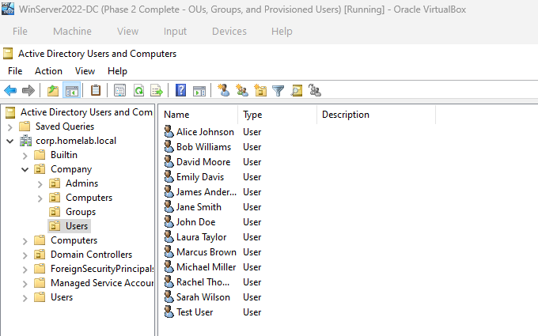
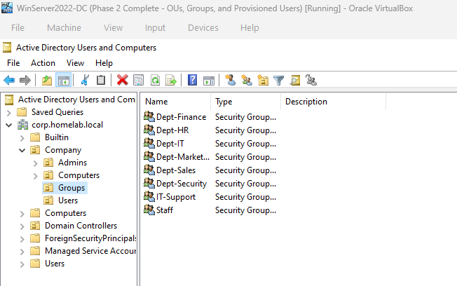
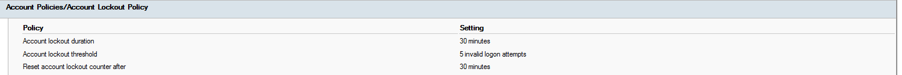
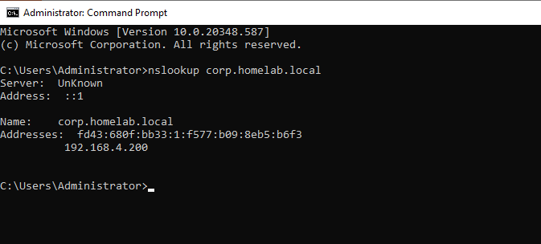
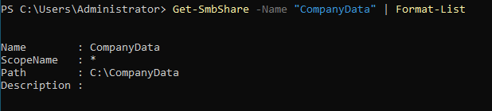
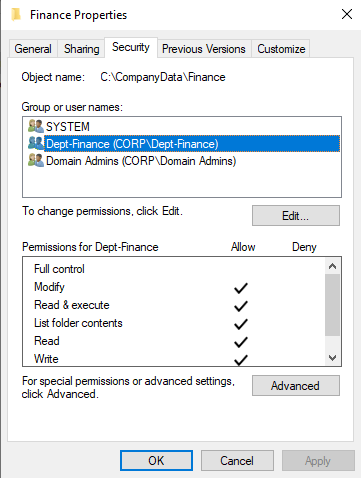
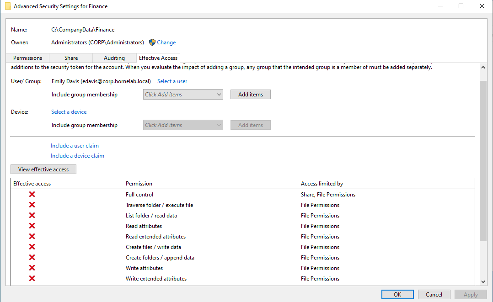

# Enterprise IT & Cybersecurity Home Lab

## Why I Built This Lab
Theory is great, but nothing beats breaking, fixing, and configuring systems yourself. In my homelab, I built this enterprise environment to turn my **CompTIA A+** and **AWS Cloud Practitioner** coursework into hands-on IT support and systems administration skills.

I structured each milestone around real-world tickets and day-to-day enterprise operations:
* **Identity & Access (AD DS):** User onboarding/offboarding, security group management, and bulk automation using **PowerShell**.
* **File Services & Access Control:** Deploying **SMB shares**, removing inheritance, and configuring granular **NTFS permissions** via **RBAC**.
* **Security & Governance:** Hardening endpoints and mitigating brute-force attacks with domain **Group Policy Objects (GPOs)**.
* **Core Networking & Troubleshooting:** Managing static IPs, diagnosing **DNS resolution**, and resolving connectivity issues.

Everything here reflects practical problem solving, clean documentation, and a focus on security by design.

---

## Lab Architecture & Milestones

| Phase | Technical Focus | Core Deliverables | Status |
| :--- | :--- | :--- | :--- |
| **Phase 1** | **Identity & Access Management (AD DS)** | OU hierarchy, PowerShell bulk onboarding, GPO Account Lockout | **Completed** |
| **Phase 2** | **File Storage & Layered Access Control** | SMB network shares, NTFS inheritance removal, RBAC validation | **Completed** |
| **Phase 3** | **Core Network Services** | DNS Forward/Reverse zones, static IP addressing, DHCP planning | Queued |
| **Phase 4** | **Secure Remote Administration & Segmentation** | RDP hardening, SSH key-based access, virtual network routing | Queued |
| **Phase 5** | **Containerized Infrastructure (Docker)** | Linux microservices, network bridge configurations, Portainer | Queued |

---

## Phase 1: Active Directory Identity Architecture & Automation

### 1. Enterprise Organizational Unit (OU) Design
Implemented a tiered parent-child OU structure under `corp.homelab.local` to cleanly separate human accounts, endpoints, and privileged administrators:
* `OU=Company` (Parent Root)
  * `OU=Users`: Standard business identities
  * `OU=Groups`: Security and functional access groups
  * `OU=Admins`: Dedicated administrative accounts segregated to prevent privilege escalation
  * `OU=Computers`: Domain workstation endpoints

### 2. Automated User & Group Provisioning (PowerShell)
Developed and executed a PowerShell automation script (`01-Active-Directory-Identity/scripts/Provision-CompanyUsers.ps1`) to:
* Bulk-provision 12 departmental user accounts across 6 business units (IT, Security, HR, Finance, Marketing, Sales).
* Dynamically generate standard `sAMAccountName` and `UserPrincipalName` attributes.
* Automatically generate departmental security groups (`Dept-*`) and assign accounts to both their functional department group and a universal `Staff` group.
* Enforce baseline initial credential standards.

### 3. Domain Hardening via Group Policy (GPO)
Mitigated brute-force and credential stuffing threats across the domain by enforcing an enterprise **Account Lockout Policy** in the Default Domain Policy:
* **Account lockout threshold:** 5 invalid logon attempts
* **Account lockout duration:** 30 minutes
* **Reset account lockout counter after:** 30 minutes

---

## Phase 1 Verification & Proof of Work

### Active Directory Hierarchy & User Population

### Departmental Security Groups

### Group Policy Account Lockout Enforcement

### Domain Controller DNS Name Resolution

---

## Phase 2: File Storage & Layered Access Control

### 1. Storage Architecture & Access Governance
Implemented a secure enterprise file server structure with strict separation between SMB share-level and NTFS file-system permissions, adhering to the principle of least privilege:
* **Share Level:** Published `\\WinServer2022-DC\CompanyData` with broad network access (`Staff` group granted Change, `Domain Admins` granted Full Control).
* **NTFS File Level:** Explicitly disabled inheritance on departmental directories to eliminate default broad access (`Users` group).
* **Role-Based Access Control (RBAC):** Mapped department security groups directly to corresponding folder ACLs:
  * `C:\CompanyData\Finance` $\rightarrow$ `corp\Dept-Finance` (Modify)
  * `C:\CompanyData\HR` $\rightarrow$ `corp\Dept-HR` (Modify)
  * `C:\CompanyData\IT` $\rightarrow$ `corp\Dept-IT` (Modify)
  * `C:\CompanyData\General` $\rightarrow$ `corp\Staff` (Modify)
  * `corp\Domain Admins` and `SYSTEM` retain Full Control across all volumes.

### 2. Automation & Scripting
* **Deployment Script:** [`02-Storage-and-Access-Control/scripts/Configure-StorageRBAC.ps1`](02-Storage-and-Access-Control/scripts/Configure-StorageRBAC.ps1)
* Programmatically provisions directories, registers the SMB share via `New-SmbShare`, strips inherited permissions via `SetAccessRuleProtection($true, $false)`, and injects granular `.NET` `FileSystemAccessRule` objects.

---

## Phase 2 Verification & Proof of Work

### SMB Share Configuration
Validates network availability, operational status, and share permissions via PowerShell.

### Explicit NTFS Access Control Lists (ACLs)
Verifies that inheritance is disabled on department shares, restricting access exclusively to `Dept-Finance`, `Domain Admins`, and `SYSTEM`.

### Advanced Effective Access Validation
Simulates cross-departmental access attempts using Windows Effective Access evaluation: HR user (`corp\edavis`) is completely blocked from accessing the Finance directory, validating RBAC boundary enforcement.

---

## Next Steps
- **Phase 3:** Deploy and configure Core Network Services (DNS forward/reverse lookup zones, static IP addressing, and DHCP scope reservation planning).