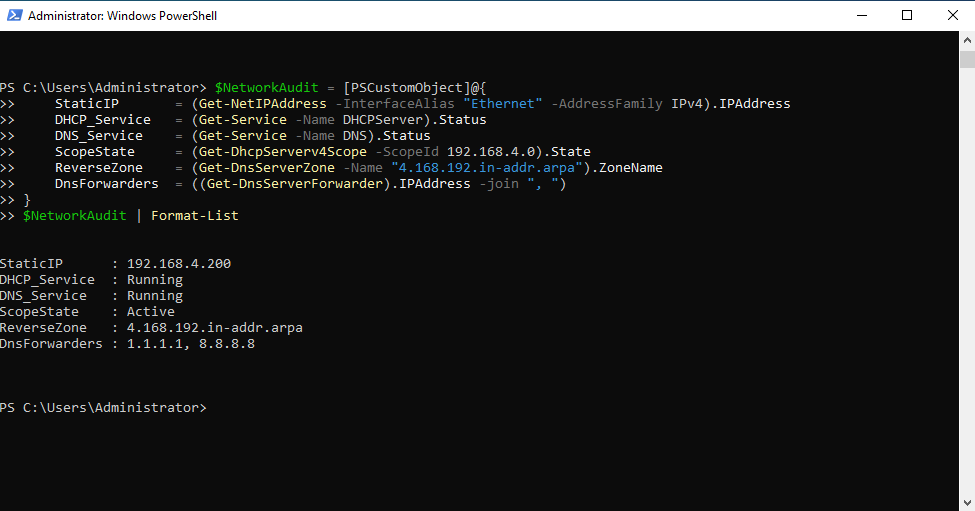
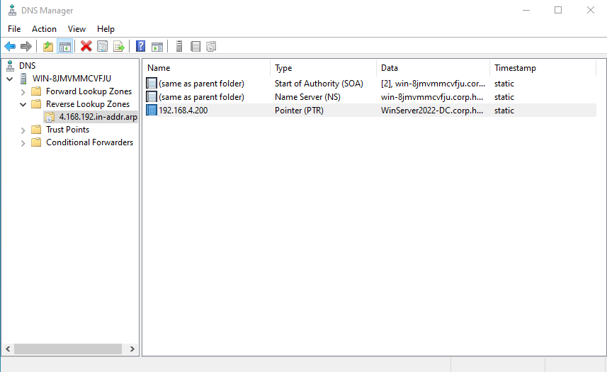
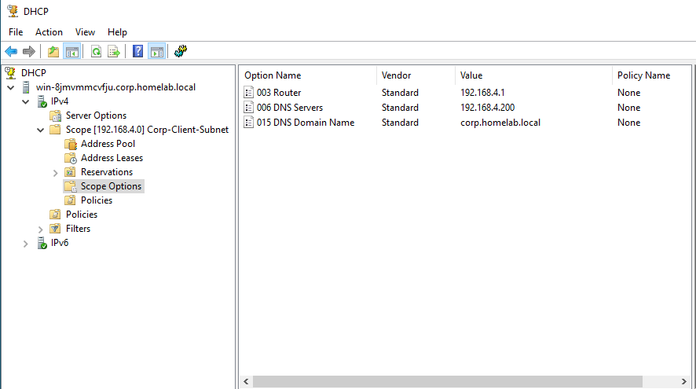

# Enterprise IT & Cybersecurity Home Lab

## Why I Built This Lab
Theory is great, but nothing beats breaking, fixing, and configuring systems yourself. In my homelab, I built this enterprise environment to turn my **CompTIA A+** and **AWS Cloud Practitioner** coursework into hands-on IT support and systems administration skills.

I structured each milestone around real-world tickets and day-to-day enterprise operations:
- **Identity & Access (AD DS):** User onboarding/offboarding, security group management, and bulk automation using **PowerShell**.
- **File Services & Access Control:** Deploying **SMB shares**, removing inheritance, and configuring granular **NTFS permissions** via **RBAC**.
- **Security & Governance:** Hardening endpoints and mitigating brute-force attacks with domain **Group Policy Objects (GPOs)**.
- **Core Networking & Troubleshooting:** Managing static IPs, diagnosing **DNS resolution**, and resolving connectivity issues.

Everything here reflects practical problem solving, clean documentation, and a focus on security by design.

---

## Lab Architecture & Milestones

| Phase | Technical Focus | Core Deliverables | Status |
| :--- | :--- | :--- | :--- |
| **Phase 1** | **Identity & Access Management (AD DS)** | OU hierarchy, PowerShell bulk onboarding, GPO Account Lockout | **Completed** |
| **Phase 2** | **File Storage & Layered Access Control** | SMB network shares, NTFS inheritance removal, RBAC validation | **Completed** |
| **Phase 3** | **Core Network Services** | Static IP hardening, DNS Reverse Lookup Zone, Upstream Forwarders, AD-Authorized DHCP | **Completed** |
| **Phase 4** | **Workstation Deployment & Domain Join** | Client DHCP lease validation, domain binding, cross-subnet authentication | Queued |
| **Phase 5** | **Secure Remote Administration & Segmentation** | RDP hardening, SSH key-based access, virtual network routing | Queued |
| **Phase 6** | **Containerized Infrastructure (Docker)** | Linux microservices, network bridge configurations, Portainer | Queued |

---

## Phase 1: Active Directory Identity Architecture & Automation

### 1. Enterprise Organizational Unit (OU) Design
Implemented a tiered parent-child OU structure under `corp.homelab.local` to cleanly separate human accounts, endpoints, and privileged administrators:
- `OU=Company` (Parent Root)
  * `OU=Users`: Standard business identities
  * `OU=Groups`: Security and functional access groups
  * `OU=Admins`: Dedicated administrative accounts segregated to prevent privilege escalation
  * `OU=Computers`: Domain workstation endpoints

### 2. Automated User & Group Provisioning (PowerShell)
Developed and executed a PowerShell automation script ([`01-Active-Directory-Identity/scripts/Provision-CompanyUsers.ps1`](01-Active-Directory-Identity/scripts/Provision-CompanyUsers.ps1)) to:
- Bulk-provision 12 departmental user accounts across 6 business units (IT, Security, HR, Finance, Marketing, Sales).
- Dynamically generate standard `sAMAccountName` and `UserPrincipalName` attributes.
- Automatically generate departmental security groups (`Dept-*`) and assign accounts to both their functional department group and a universal `Staff` group.
- Enforce baseline initial credential standards.

### 3. Domain Hardening via Group Policy (GPO)
Mitigated brute-force and credential stuffing threats across the domain by enforcing an enterprise **Account Lockout Policy** in the Default Domain Policy:
- **Account lockout threshold:** 5 invalid logon attempts
- **Account lockout duration:** 30 minutes
- **Reset account lockout counter after:** 30 minutes

---

## Phase 1 Verification & Proof of Work

### Active Directory Hierarchy & User Population

### Departmental Security Groups

### Group Policy Account Lockout Enforcement

### Domain Controller DNS Name Resolution

---

## Phase 2: File Storage & Layered Access Control

### 1. Storage Architecture & Access Governance
Implemented a secure enterprise file server structure with strict separation between SMB share-level and NTFS file-system permissions, adhering to the principle of least privilege:
- **Share Level:** Published `\\WinServer2022-DC\CompanyData` with broad network access (`Staff` group granted Change, `Domain Admins` granted Full Control).
- **NTFS File Level:** Explicitly disabled inheritance on departmental directories to eliminate default broad access (`Users` group).
- **Role-Based Access Control (RBAC):** Mapped department security groups directly to corresponding folder ACLs:
  * `C:\CompanyData\Finance` $\rightarrow$ `corp\Dept-Finance` (Modify)
  * `C:\CompanyData\HR` $\rightarrow$ `corp\Dept-HR` (Modify)
  * `C:\CompanyData\IT` $\rightarrow$ `corp\Dept-IT` (Modify)
  * `C:\CompanyData\General` $\rightarrow$ `corp\Staff` (Modify)
  * `corp\Domain Admins` and `SYSTEM` retain Full Control across all volumes.

### 2. Automation & Scripting
- **Deployment Script:** [`02-Storage-and-Access-Control/scripts/Configure-StorageRBAC.ps1`](02-Storage-and-Access-Control/scripts/Configure-StorageRBAC.ps1)
- Programmatically provisions directories, registers the SMB share via `New-SmbShare`, strips inherited permissions via `SetAccessRuleProtection($true, $false)`, and injects granular `.NET` `FileSystemAccessRule` objects.

---

## Phase 2 Verification & Proof of Work

### SMB Share Configuration
Validates network availability, operational status, and share permissions via PowerShell.

### Explicit NTFS Access Control Lists (ACLs)
Verifies that inheritance is disabled on department shares, restricting access exclusively to `Dept-Finance`, `Domain Admins`, and `SYSTEM`.

### Advanced Effective Access Validation
Simulates cross-departmental access attempts using Windows Effective Access evaluation: HR user (`corp\edavis`) is completely blocked from accessing the Finance directory, validating RBAC boundary enforcement.

---

## Phase 3: Core Network Services (Static IP, DNS & DHCP)

### 1. Network Adapter Hardening & Static Configuration
Secured the Domain Controller's network interface by permanently disabling dynamic assignment and locking down enterprise addressing:
- **Static IPv4 Address:** `192.168.4.200/24`
- **Default Gateway:** `192.168.4.1`
- **DNS Server Binding:** `127.0.0.1` (loopback to ensure local Active Directory resolution)

### 2. DNS Infrastructure & Resolution Architecture
- **Active Directory-Integrated Reverse Lookup Zone:** Configured `4.168.192.in-addr.arpa` to allow PTR lookups required by Kerberos authentication, security logging, and SIEM hostname correlation.
- **PTR Record Registration:** Mapped `192.168.4.200` to `WIN-8JMVMMCVFJU.corp.homelab.local`.
- **Public Upstream Forwarders:** Bound external resolvers (`1.1.1.1` and `8.8.8.8`) to the DNS service, ensuring fast public internet name resolution while keeping all internal queries handled locally.

### 3. Enterprise DHCP Deployment & Active Directory Authorization
- Deployed the Windows Server DHCP role and authorized the instance in Active Directory (`Add-DhcpServerInDC`) to prevent rogue DHCP assignment.
- **Scope Parameters (`Corp-Client-Subnet`):**
  * Subnet: `192.168.4.0/24`
  * Distribution Pool: `192.168.4.50` – `192.168.4.150`
  * Excluded/Reserved Space: `192.168.4.1`–`.49` and `192.168.4.151`–`.254` (protecting DC and network appliances)
- **Scope Options Configured:**
  * `Option 003 (Router / Default Gateway)`: `192.168.4.1`
  * `Option 006 (DNS Servers)`: `192.168.4.200`
  * `Option 015 (DNS Domain Name)`: `corp.homelab.local`

### 4. Automation & Validation Artifacts
- **Deployment Script:** [`03-Core-Network-Services/scripts/Configure-NetworkServices.ps1`](03-Core-Network-Services/scripts/Configure-NetworkServices.ps1)
- **Service Audit Log:** [`03-Core-Network-Services/Phase3-NetworkServices-Validation.txt`](03-Core-Network-Services/Phase3-NetworkServices-Validation.txt) (Captures runtime service states, static IP bindings, and scope activation via PowerShell)

---

## Phase 3 Verification & Proof of Work

### Core Network Services CLI Audit
Verifies static IP binding, service run-states, scope activation, reverse zone binding, and forwarders via PowerShell.

### DNS Reverse Lookup Zone & Host PTR Record
Displays the active `4.168.192.in-addr.arpa` zone and the static PTR record resolving `.200` back to the Domain Controller.

### Active Directory-Authorized DHCP Scope & Options
Demonstrates the active client scope and configured scope options (Router, DNS, Domain Name) in the DHCP Management Console.

---

## Next Steps
- **Phase 4:** Workstation Deployment & Domain Join (Provision Windows 10/11 client VM, verify dynamic DHCP lease from DC, execute Active Directory domain join, and validate SMB share access across domain user profiles).
- **Phase 5:** Secure Remote Administration & Segmentation (RDP hardening, SSH key-based access, virtual network routing).
- **Phase 6:** Containerized Infrastructure (Docker, Portainer, Linux microservices).